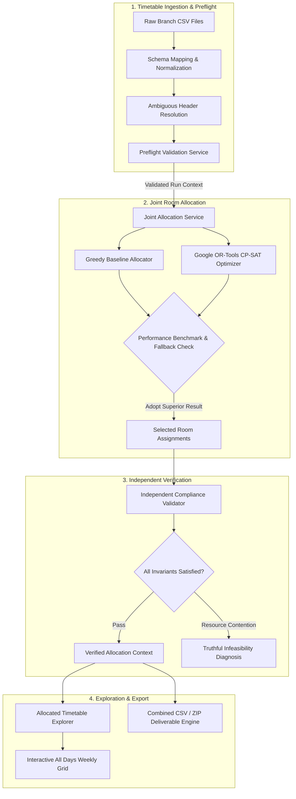

# ClassroomIQ — Smart Academic Classroom & Facility Allocation Engine

ClassroomIQ is an automated academic scheduling and room allocation system designed to optimize room utilization, eliminate scheduling conflicts, and minimize campus transit time for students and faculty across multi-department higher-education institutions.

The system combines a **Constraint Satisfaction Programming (CP-SAT)** optimization engine with a **REST API bridge** and an interactive, dependency-free **web application**. It supports both institutional batch scheduling across pre-loaded campus datasets and a dedicated **upload-first joint allocation workflow** for departmental raw timetable CSVs.

---

## 1. Problem Statement & Solution

### The Challenge
Higher-education campus scheduling frequently suffers from:
- **Fragmented Departmental Scheduling:** Individual academic programs schedule classes independently, creating severe contention for shared physical infrastructure (laboratories, lecture halls, computing facilities).
- **Physical Room Inefficiencies:** Classes assigned without regard to campus geography force students and instructors to sprint between opposite ends of the campus between consecutive periods.
- **Resource Clashes:** Manual room assignment frequently introduces room double-bookings, cohort timing conflicts, or room-type capability mismatches (e.g., placing programming labs in standard seminar rooms).
- **Inflexible Disruption Handling:** Room maintenance outages and emergency room closures require time-consuming manual re-allocation, often triggering cascading scheduling ripples across unaffected cohorts.

### The ClassroomIQ Solution
ClassroomIQ resolves these bottlenecks by treating classroom allocation as a mathematically bounded constraint satisfaction problem:
1. **Unified Multi-Program Ingestion:** Ingests unallocated raw timetables across multiple academic branches simultaneously.
2. **CP-SAT Mathematical Optimization:** Maximizes placement efficiency while minimizing transit walking distance across a calibrated campus distance matrix.
3. **Independent Formal Auditing:** Runs an uncompromised verification engine that validates every assignment against room-type capability, time exclusivity, and cohort scheduling boundaries.
4. **Truthful Reporting & Diagnostics:** Avoids silent session omissions by providing detailed feasibility diagnostics, explaining exact causes of resource contention when capacity bounds are exceeded.
5. **Interactive Exploration & Export:** Renders complete weekly schedules in responsive multi-grouping timetable views and packages complete allocation results into downloadable CSV and ZIP archives.

---

## 2. Key Features

- **Upload-First Multi-Timetable Pipeline:** Upload multiple departmental timetable CSV files simultaneously, parse headers automatically, and validate formatting before allocation.
- **Ambiguous Header Mapping Guard:** Flags ambiguous column names (e.g., `department` vs. `program`) and requires explicit confirmation rather than making silent assumptions.
- **Joint Multi-Program CP-SAT Allocation:** Simultaneously allocates shared physical inventory (86 rooms across 10 buildings) across competing academic branches with zero double-bookings.
- **Campus Transit Minimization:** Leverages a campus-wide Manhattan/Euclidean walking time matrix to cluster consecutive classes for the same student cohort in proximal physical buildings.
- **Guaranteed Baseline-Protection Fallback:** Benchmarks the CP-SAT candidate against a fast greedy heuristic. If the optimizerregresses or times out, the baseline allocation is safely retained.
- **Unified Weekly Timetable Grid:** Renders complete Monday–Friday weekly timetables in chronological order, with grouping toggles for **Cohort**, **Program**, and **Room** views.
- **Multi-Period Lab Block Preservation:** Preserves multi-hour laboratory sessions as single visual blocks spanning consecutive period columns (P1–P8) with duration badges, rather than duplicating cells.
- **Dual Evaluation Modes:**
  - **Synthetic Demo Profile:** Applies realistic synthetic student demand and operational availability estimates for rapid prototyping and demonstration.
  - **Factual Mode:** Enforces strict provenance; audits unverified room capacities and availability assumptions without synthetic substitution.
- **Disruption Sandbox:** Simulates emergency room outages and evaluates local search (Simulated Annealing) repairs against frozen baseline schedules.
- **Complete Deliverables Export:** Generates standardized combined CSV schedules and full ZIP packages compliant with institutional reporting formats.

---

## 3. How the System Works

ClassroomIQ operates through an end-to-end 7-step pipeline:



1. **Ingestion & Normalization:** Uploaded CSVs are parsed, stripped of byte order marks (BOM), mapped against standard schema keys, and assigned unique run identifiers.
2. **Preflight Validation:** Verifies period bounds (Periods 1–8), academic cycle consistency, and intra-file cohort non-overlap. Identifies blocking syntax errors and non-blocking warnings.
3. **Joint Allocation:** Sessions from all uploaded branches are pooled into a single solver context. The engine solves room assignment across physical rooms using OR-Tools CP-SAT with a configurable time limit (1.0–10.0s).
4. **Independent Auditing:** The `IndependentValidator` audits assignments against room capabilities, physical double-bookings, cohort clashes, and travel limits.
5. **Interactive Visualization:** The frontend presents the active allocation across Monday–Friday, enabling real-time filtering by Program, Cohort, Day, and Room.
6. **Package Generation:** The export service generates combined CSV files and zipped bundles containing file manifests, branch schedules, and validation summaries.

---

## 4. System Architecture

ClassroomIQ is constructed with clean architectural separation between optimization logic, web delivery, and the user interface:

```mermaid
graph TB
    subgraph Client ["Frontend Client (Browser SPA)"]
        UI[Single Page App - index.html]
        CSS[Vanilla CSS Design System - index.css]
        APP[App Controller & State - js/app.js]
        API[API Client Bridge - js/api.js]
    end

    subgraph Server ["Backend REST Bridge (FastAPI)"]
        MAIN[Application Entrypoint - main.py]
        R_UPLOAD[/api/upload/* - upload.py]
        R_ALLOC[/api/allocation/* - allocation.py]
        R_INVENT[/api/rooms, /api/timetables - inventory.py]
        R_VALID[/api/validation/* - validation.py]
        R_SIM[/api/simulation/* - simulation.py]
        R_STATUS[/api/status, /api/health - status.py]
    end

    subgraph Services ["Application Services Layer"]
        SVC_UPLOAD[UploadService]
        SVC_JOINT[JointAllocationService]
        SVC_EXPORT[ExportService]
        SVC_TRAVEL[TravelMatrixService]
        SVC_SYNTH[SyntheticProfileService]
        SVC_LOADER[DataLoaderService]
    end

    subgraph Core ["Optimization & Correctness Core"]
        CPSAT[CPSATRoomOptimizer - OR-Tools]
        BASE[GreedyBaselineAllocator]
        ANNEAL[SimulatedAnnealingRepairer]
        VALID[IndependentValidator]
    end

    subgraph Storage ["Storage & Memory Model"]
        REGISTRY[(In-Memory Run Context Registry)]
        SEED_DATA[(Canonical Seed Datasets - data/*.csv)]
        FIXTURES[(Raw Timetable Fixtures - test_fixtures/)]
    end

    UI --> APP
    APP --> API
    API -->|HTTP REST| MAIN

    MAIN --> R_UPLOAD
    MAIN --> R_ALLOC
    MAIN --> R_INVENT
    MAIN --> R_VALID
    MAIN --> R_SIM
    MAIN --> R_STATUS

    R_UPLOAD --> SVC_UPLOAD
    R_UPLOAD --> SVC_JOINT
    R_UPLOAD --> SVC_EXPORT
    R_ALLOC --> CPSAT
    R_ALLOC --> BASE
    R_VALID --> VALID
    R_SIM --> ANNEAL
    R_INVENT --> SVC_LOADER

    SVC_JOINT --> CPSAT
    SVC_JOINT --> BASE
    SVC_JOINT --> VALID
    SVC_JOINT --> REGISTRY
    SVC_UPLOAD --> REGISTRY
    SVC_LOADER --> SEED_DATA
```

---

## 5. Optimization & Mathematical Approach

### Core Allocators

1. **Greedy Baseline Allocator (`GreedyBaselineAllocator`):**
   - Sequential heuristic sorting sessions by cohort size and duration.
   - Places sessions in the first available valid room meeting capacity and room-type requirements.
   - Provides a benchmark for optimization improvement and guarantees a fallback solution.

2. **Constraint Programming Solver (`CPSATRoomOptimizer`):**
   - Formulates allocation as an integer programming model using Google OR-Tools CP-SAT.
   - **Decision Variables:** Binary variables $x_{s,r} \in \{0, 1\}$ denoting whether session occurrence $s$ is placed in room $r$.
   - **Hard Constraint 1 (Room Capability):** $x_{s,r} = 0$ if room type of $r$ does not satisfy the required room type of $s$ (e.g., laboratory sessions must map to laboratory rooms).
   - **Hard Constraint 2 (Room-Time Exclusivity):** For every physical room $r$, day $d$, and period $p$:
     $$\sum_{s \in \text{Sessions}(d, p)} x_{s,r} \le 1$$
     Ensures zero room double-bookings.
   - **Hard Constraint 3 (Cohort-Time Exclusivity):** For every student cohort $c$, day $d$, and period $p$:
     $$\sum_{s \in \text{Sessions}(c, d, p)} x_{s,r} \le 1$$
     Guarantees students are never scheduled in two places simultaneously.
   - **Objective Function:** Minimize total campus transit walking time between consecutive classes for each student cohort based on the distance travel matrix:
     $$\min \sum_{(s_1, s_2) \in \text{Consecutive}} \text{WalkingTime}(\text{Room}(s_1), \text{Room}(s_2))$$

3. **Disruption Repair (`SimulatedAnnealingRepairer`):**
   - Handles operational room outages using simulated annealing.
   - Minimizes ripple reassignments while finding valid alternate rooms for affected sessions.

### Safe Fallback & Truthful Infeasibility
- **Baseline Protection:** If the CP-SAT solver exceeds its configured time limit or regresses against the greedy baseline on walking time, the system automatically falls back to the baseline allocation.
- **No Silent Omissions:** If the available physical inventory is insufficient to place all sessions, ClassroomIQ explicitly flags unassigned sessions, provides an infeasibility diagnosis, and lists exact session IDs that could not be accommodated.

---

## 6. Technology Stack

### Backend
- **Python 3.14+** (compatible with Python 3.10+)
- **FastAPI (v0.141.1):** High-performance async REST API framework.
- **Google OR-Tools (v9.15.6755):** CP-SAT constraint programming solver.
- **Pydantic (v2.13.4):** Data validation and schema enforcement.
- **Uvicorn (v0.53.0):** ASGI production web server.

### Frontend
- **HTML5 & Vanilla CSS3:** Modern responsive layout, glassmorphic card styling, CSS grid timetable views.
- **Vanilla ES6+ JavaScript:** Modular design with native ES modules, async/await HTTP client, and zero external npm/build dependencies.

### Testing & Infrastructure
- **pytest (v9.1.1) & anyio:** Automated unit, integration, and end-to-end regression testing.
- **FastAPI TestClient & HTTPX:** In-process HTTP integration testing.
- **Standard Library:** `csv`, `zipfile`, `hashlib`, `math`, `dataclasses`.

---

## 7. Repository Structure

```text
CommitCon/
├── backend/
│   ├── app/
│   │   ├── api/                  # REST API route handlers
│   │   │   ├── allocation.py     # Batch allocation endpoints
│   │   │   ├── inventory.py      # Room, session, and timetable endpoints
│   │   │   ├── simulation.py     # Disruption sandbox endpoints
│   │   │   ├── status.py         # System health and dataset manifests
│   │   │   ├── upload.py         # Upload preflight, allocate, timetable, export
│   │   │   └── validation.py     # Independent validation endpoints
│   │   ├── core/                 # Core mathematical algorithms (P4-P6 baseline)
│   │   │   ├── baseline_allocator.py   # Greedy allocation heuristic
│   │   │   ├── cpsat_optimizer.py      # Google OR-Tools CP-SAT optimizer
│   │   │   ├── simulated_annealing.py  # Disruption repair metaheuristic
│   │   │   └── validator.py            # Independent compliance validator
│   │   ├── schemas/              # Pydantic data transfer schemas
│   │   │   ├── models.py         # Domain models (Room, Session, Cohort, Building)
│   │   │   └── upload.py         # Upload payloads, responses, and grid schemas
│   │   ├── services/             # Core business logic services
│   │   │   ├── data_loader.py    # CSV seed dataset loader
│   │   │   ├── export_service.py # Combined CSV and ZIP archive generator
│   │   │   ├── joint_allocation_service.py # Joint multi-program allocator
│   │   │   ├── synthetic_profile.py        # Demo demand and availability profile
│   │   │   ├── travel_matrix.py  # Campus distance matrix calculator
│   │   │   └── upload_service.py # Preflight parser, normalizer, and registry
│   │   └── main.py               # FastAPI application entrypoint & static mount
│   └── tests/                    # Automated pytest test suite (103 tests)
│       ├── test_api.py           # REST API endpoint tests
│       ├── test_baseline.py      # Greedy allocator unit tests
│       ├── test_data_loader.py   # Dataset ingestion and hash verification
│       ├── test_e2e_milestone5.py# End-to-end multi-branch upload regression tests
│       ├── test_metrics.py       # Walking distance and efficiency metrics
│       ├── test_optimizer.py     # CP-SAT solver constraint validation
│       ├── test_simulation.py    # Disruption sandbox simulation tests
│       ├── test_travel_matrix.py # Campus geography travel tests
│       ├── test_upload_pipeline.py # Preflight parser and mapping tests
│       └── test_validator.py     # Independent validation audit tests
├── data/                         # Canonical baseline seed datasets (7 files)
│   ├── buildings.csv             # 10 campus buildings
│   ├── curricula.csv             # 116 curriculum requirements
│   ├── departments.csv           # 7 academic departments
│   ├── faculty.csv               # 88 faculty members
│   ├── programs.csv              # 5 academic degree programs
│   ├── rooms.csv                 # 86 physical rooms and laboratories
│   └── sessions.csv              # 1,250 scheduled institutional sessions
├── docs/                         # Authoritative project specifications & governance
│   ├── ClassroomIQ_Document_05_Implementation_Roadmap_and_Build_Authorization_v0.2.0.docx
│   ├── ClassroomIQ_UI_Benchmark_Approved_Reference.jpg
│   └── ...
├── frontend/                     # Web application SPA assets
│   ├── css/
│   │   └── index.css             # Unified CSS tokens, components, and layout
│   ├── js/
│   │   ├── api.js                # REST API fetch bridge
│   │   └── app.js                # UI controller, state manager, timetable renderer
│   └── index.html                # Single-page application entrypoint
├── test_fixtures/                # Realistic multi-program raw timetable fixtures
│   └── semester_iii_raw_timetables/
│       ├── computational_finance_semester_iii.csv    # 28 session records
│       ├── cyber_security_semester_iii.csv           # 28 session records
│       ├── data_science_semester_iii.csv             # 28 session records
│       ├── software_systems_semester_iii.csv         # 28 session records
│       ├── theoretical_computer_science_semester_iii.csv # 28 session records
│       ├── combined_semester_iii_all_five_branches.csv # 140 review records
│       └── README_Data_Mapping_and_Quality_Report.md  # Fixture mapping specification
└── README.md                     # Root project documentation
```

---

## 8. Installation & Setup

### Prerequisites
- **Python 3.10+** (Python 3.12 or 3.14 recommended)
- **Git**
- A modern web browser (Google Chrome, Microsoft Edge, Mozilla Firefox)

### Step 1: Clone the Repository
```bash
git clone https://github.com/aditya-p-1634/classroom-allocation.git
cd classroom-allocation
git checkout feature/phase-p7-frontend-integration
```

### Step 2: Install Python Dependencies
Install the required packages in your Python environment:
```bash
pip install fastapi uvicorn ortools pydantic pytest httpx python-docx
```

### Step 3: Start the Backend Server
Launch the FastAPI development server from the repository root:
```bash
python -m uvicorn backend.app.main:app --host 127.0.0.1 --port 8000 --reload
```
The server will start at `http://127.0.0.1:8000/`.
- **API Documentation (Swagger UI):** `http://127.0.0.1:8000/docs`
- **Application Frontend:** `http://127.0.0.1:8000/`

---

## 9. Running the Automated Test Suite

ClassroomIQ includes a comprehensive test suite of **103 automated tests** covering preflight parsing, mathematical solver correctness, walking distance calculations, disruption recovery, and end-to-end upload workflows.

To run the complete test suite:
```bash
python -m pytest
```

To run specific test modules:
```bash
# Run the end-to-end multi-branch upload and timetable regression suite
python -m pytest backend/tests/test_e2e_milestone5.py -v

# Run the CP-SAT optimizer constraint tests
python -m pytest backend/tests/test_optimizer.py -v

# Run the preflight parser and normalization tests
python -m pytest backend/tests/test_upload_pipeline.py -v
```

---

## 10. Using the Semester III Timetable Fixtures

The repository includes five authentic raw timetable CSV fixtures located in:
`test_fixtures/semester_iii_raw_timetables/`

| Fixture File | Program | Cohort ID | Total Sessions | Lab Blocks |
| :--- | :--- | :--- | :---: | :---: |
| `computational_finance_semester_iii.csv` | Computational Finance | `odd_sem3_CF` | 28 | 6 |
| `cyber_security_semester_iii.csv` | Cyber Security | `odd_sem3_CY` | 28 | 6 |
| `data_science_semester_iii.csv` | Data Science | `odd_sem3_DS` | 28 | 6 |
| `software_systems_semester_iii.csv` | Software Systems | `odd_sem3_SS` | 28 | 6 |
| `theoretical_computer_science_semester_iii.csv` | Theoretical Computer Science | `odd_sem3_TCS` | 28 | 6 |
| **Combined Review Dataset** | **All 5 Programs** | **5 Cohorts** | **140** | **30** |

### Key Input Characteristics
- **Standardized Schema:** `program, cohort_id, course, academic_cycle, day, start_period, end_period, required_room_type, semester, session_type, student_count, required_facilities`
- **Period Bounds:** Bounded to **Periods 1–8** (P1 08:30–09:20 through P8 16:20–17:10).
- **Multi-Period Labs:** Two-period lab blocks are defined with `start_period` and `end_period` (e.g., `start_period: 1, end_period: 2`) as single occurrences.
- **Unassigned Rooms:** The files contain no pre-assigned room IDs, serving as clean inputs for joint optimization.

---

## 11. Example First-Time User Workflow

Follow this walkthrough to test the multi-timetable upload and allocation workflow:

1. **Launch Application:** Navigate to `http://127.0.0.1:8000/` in your browser.
2. **Access Upload Module:** Click **Upload Timetable** in the primary navigation bar.
3. **Load Canonical Timetables:**
   - Click the button **⚡ Load Real Semester III Timetables (140 Sessions)** (or drag-and-drop the five fixture files from `test_fixtures/semester_iii_raw_timetables/`).
   - The UI displays **5 files • 140 sessions** loaded.
4. **Inspect Preflight Validation:**
   - Confirm that the preflight summary shows: *✓ Clean Ingestion: All 140 session occurrences parsed cleanly with zero blocking errors across periods 1–8.*
5. **Configure Optimization:**
   - Click **Proceed to Joint Allocation**.
   - Select evaluation mode (**Synthetic Demo Profile** recommended for demo runs).
   - Set solver time limit (default: 5.0 seconds).
   - Click **Run Joint Multi-Program Allocation**.
6. **Evaluate Allocation Results:**
   - Review solver metrics: **140 / 140 Placed (100%)**, zero hard collisions, solver name (`CPSATRoomOptimizer`), and walking time reduction percentage.
7. **Explore the Weekly Timetable:**
   - Scroll to **Step 6: Allocated Timetable Explorer**.
   - Click **All Days** in the weekday selector to view the complete Monday–Friday schedule.
   - Select **By Cohort** grouping and filter to **Software Systems**:
     - Confirm all **28 session occurrences** populate across Monday–Friday.
     - Observe multi-period labs (e.g., *Algorithms Lab*) spanning Periods 1–2 with a blue duration badge.
   - Switch the program filter to **All Programs** to inspect all 140 sessions collectively.
   - Click on any session card to open the **Session Provenance Inspector** displaying source file, row number, and assigned room.
8. **Export Deliverables:**
   - In **Step 7: Download Allocation Deliverables**, click **Download Combined CSV** or **Download Deliverables ZIP** to export the standardized scheduling package.

---

## 12. Demonstration Assumptions & Evaluation Modes

To maintain scientific integrity and prevent demo estimations from being confused with institutional facts, ClassroomIQ provides two evaluation modes:

### Synthetic Demo Profile (Default for Demonstrations)
- **Context:** Raw timetable spreadsheets collected from academic departments frequently omit physical room inventory availability or real-time student enrollment figures.
- **Assumptions Applied:**
  - In fresh upload runs, physical rooms from the institutional inventory are assumed available unless reserved.
  - Student cohort demand is derived from synthetic cohort profile estimates.
- **Purpose:** Enables end-to-end solver execution, spatial optimization, and interactive UI exploration during hackathon presentations and evaluations.

### Factual Mode
- **Context:** Used when auditing institutional data strictly against verified evidence.
- **Behavior:**
  - Does not substitute unverified room capacities or availability estimates.
  - Truthfully flags unverified room capacities and physical operational limits in the validation report.
  - Disables synthetic metrics and reports data gaps as auditable evidence limitations.

---

## 13. Limitations & Constraints

- **Period Bounds:** Timetable uploads are bounded strictly to **Periods 1–8** (08:30–17:10). Period 9 is reserved for institutional special events per governance specification.
- **In-Memory Run Persistence:** Upload runs and active joint allocations are maintained in an in-memory session registry (`UploadService._registry`). Active runs do not persist across backend server restarts (export deliverables provide persistent disk storage).
- **Supported Formats:** The upload pipeline currently accepts CSV files. Excel (`.xlsx`) or PDF timetable files must be converted to CSV prior to ingestion.
- **Solver Time Bounds:** Solvers operate with configurable hard timeouts (1.0–10.0 seconds) to ensure responsive web interaction. Complex contention scenarios trigger safe baseline-protection fallback.

---

## 14. Project Status & Roadmap

### Current Status: Phase P7 Formally Accepted & Closed
- **Phase P7 Scope:** REST API Bridge, Frontend Integration, and Upload-First Multi-Timetable Joint Allocation are complete, verified by 103 automated tests, and formally closed under Document 05 revision **v0.2.7**.
- **Dataset Integrity:** All seven canonical baseline datasets in `data/` remain 100% bit-for-bit identical to baseline commit `9f6fea2`.
- **Core Algorithms:** P4–P6 optimization and simulation modules are preserved unchanged.

### Future Improvement Opportunities (Gated Phases)
- **Phase P8 (Performance Benchmarking):** Heavy-load scalability profiling, solver search convergence benchmarking, and large-cohort stress testing.
- **Phase P9 (Presentation & Production Packaging):** Automated presentation deck generation, multi-tenant database persistence (PostgreSQL/SQLAlchemy), and cloud containerization (Docker).

---

## 15. License & Academic Attribution

Developed as part of the ClassroomIQ Academic Scheduling Initiative. Built with FastAPI and Google OR-Tools. Canonical seed datasets and test fixtures are preserved for reproducibility and benchmarking.
